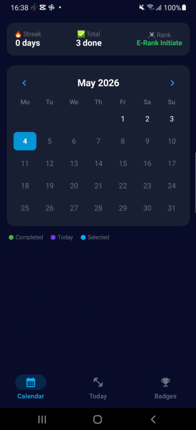
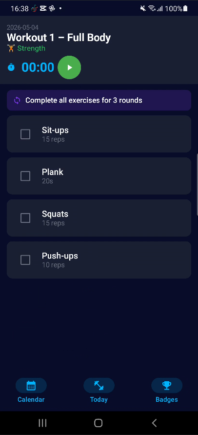
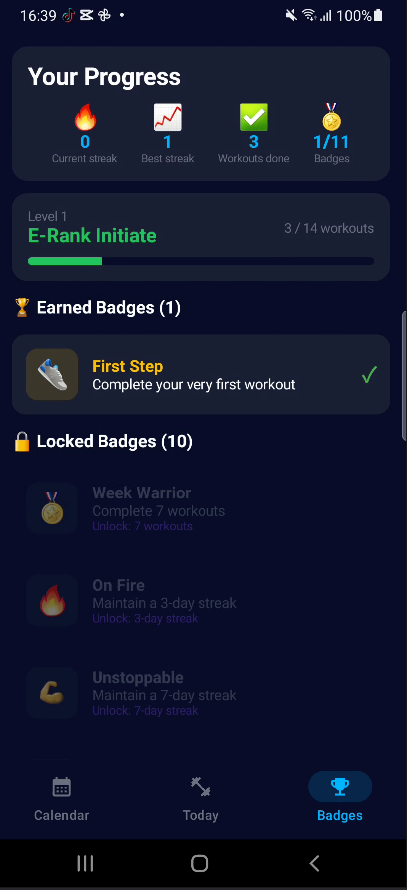

# ⚔️ Workout Level Up — Android App

A Solo Leveling-inspired workout tracker built with **Kotlin + Jetpack Compose**, featuring a Room database,
ViewModel, a monthly calendar, a daily exercise checklist, a streak + badge system, and daily push notifications.

---

## 🏗️ Architecture

```
app/
└── src/main/java/com/example/workoutlevelup/
    ├── data/
    │   ├── WorkoutDay.kt          ← Room entity
    │   ├── WorkoutDayDao.kt       ← DAO queries
    │   └── AppDatabase.kt         ← Room singleton
    ├── model/
    │   └── WorkoutPlan.kt         ← 4-level training plan + badge definitions
    ├── repository/
    │   └── WorkoutRepository.kt   ← Data access abstraction + streak logic
    ├── viewmodel/
    │   └── WorkoutViewModel.kt    ← StateFlow-based UI state + business logic
    ├── ui/
    │   ├── theme/
    │   │   ├── Color.kt
    │   │   ├── Theme.kt
    │   │   └── Type.kt
    │   ├── screens/
    │   │   ├── CalendarScreen.kt  ← Monthly calendar view
    │   │   ├── DailyWorkoutScreen.kt ← Exercise checklist + live timer
    │   │   └── BadgesScreen.kt    ← Streak / badges / level progress
    │   └── navigation/
    │       └── AppNavigation.kt   ← Bottom nav + NavHost
    ├── notifications/
    │   └── WorkoutReminderWorker.kt ← WorkManager daily notification
    ├── WorkoutApplication.kt      ← Initialises WorkManager on startup
    └── MainActivity.kt            ← Entry point
```

---

## 📋 Training Plan (4 Levels)

| Level | Rank            | Unlock condition  |
|-------|-----------------|-------------------|
| 1     | E-Rank Initiate | Start              |
| 2     | E-Rank Hunter   | 14 completed days  |
| 3     | B-Rank Hunter   | 30 completed days  |
| 4     | S-Rank Hunter ⚡ | 60 completed days  |

---

## 🏅 Badge System

| Badge          | Requirement                  |
|----------------|------------------------------|
| First Step     | Complete 1 workout           |
| Week Warrior   | Complete 7 workouts          |
| On Fire 🔥     | 3-day streak                 |
| Unstoppable 💪 | 7-day streak                 |
| Iron Will 🦾   | 30-day streak                |
| E-Rank Hunter  | Reach Level 2                |
| B-Rank Hunter  | Reach Level 3                |
| S-Rank Hunter ⚡| Reach Level 4               |
| Half Century   | Complete 50 workouts         |
| Centurion 🏆   | Complete 100 workouts        |
| Consistent     | Complete 30 workouts total   |

---

## 🔔 Notifications

Daily reminders are scheduled automatically via **WorkManager** at **18:00** every day.
To change the time, edit `WorkoutApplication.kt`:

```kotlin
WorkoutReminderWorker.scheduleDailyReminder(context, hourOfDay = 18, minute = 0)
```

On Android 13+ the app requests `POST_NOTIFICATIONS` permission on first launch.

---

## 🚀 Setup

1. Open the project root `WorkoutLevelUp/` in **Android Studio Hedgehog (2023.1.1+)**
2. Let Gradle sync finish
3. Run on an emulator or device running **API 24+**

> **Min SDK:** 24 (Android 7.0)  
> **Target SDK:** 34  
> **Kotlin:** 1.9.20  
> **Compose BOM:** 2024.02.00  

---

## 💡 System Rules

- Never skip 2 days in a row
- Increase reps by +5 every week
- Take progress photos every 2 weeks
- When you think you're done → **do 5 more reps**




